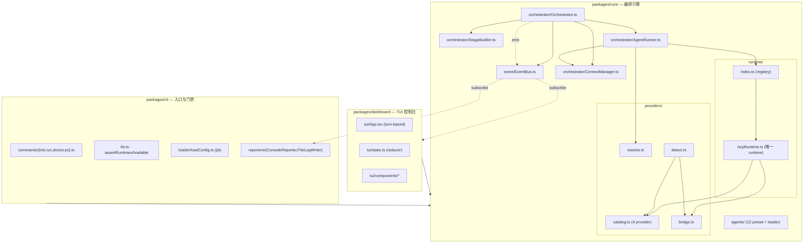

# multiclaw 架构与代码 / TUI 优化评审

> 评审人：高见远（Architect）
> 日期：2026-10-13
> 范围：`packages/core`（编排 / runtime / providers）、`packages/cli`、`packages/dashboard`（TUI）
> 方法：通读真实源码 + RFC 0001 + 项目 memory，逐条结论附【文件:行号】证据
> 约定：**【新发现】** = 本次评审新提出、RFC 0001 / memory 均未记录；**【已知】** = RFC 或 memory 已记录（仅评估优先级）

---

## 1. 架构现状速览

### 1.1 分层图

### 1.2 三大核心的实现路径

| 核心 | 实现路径 | 关键位置 |
|------|----------|----------|
| **① agent team 编排** | `Orchestrator.run()` → `resolveTurn()`（leader 三态路由 run/reply/ask）→ `buildStages()` 拓扑分层 → 逐 stage `Promise.all` 并行 → architect 写 `task-plan.json` 后 `applyTaskPlan()` 重排 → 事件总线广播 | `Orchestrator.ts:41-181`、`StageBuilder.ts:3-28` |
| **② 多 provider** | `catalog.ts` 声明 4 个 provider 的 `command/args/meta/tools/modelSelection/models`；`resolve.ts` 纯函数逐级解析 provider→command→args→model；`AcpRuntime` 用 `specForCommand(command)` 分派 `_meta` 命名空间、tool allowlist、model 下发；`detect.ts` 探测本机 | `catalog.ts:66-168`、`resolve.ts:9-61`、`AcpRuntime.ts:252-605` |
| **③ TUI 控制台** | Ink 全屏（alternate screen）；`App.tsx` 用 `useReducer` 维护 `TuiState`（`TurnView` + `history` + `view`）；事件经 80ms 批量 flush 进 reducer；turn-based，运行中提交=入队 | `App.tsx:142-779`、`state.ts:510-594`、`index.ts:23-41` |

### 1.3 总体评价

架构**分层清晰、边界克制**：`AgentRuntime` 接口冻结、`describe()` SDK-free、core 无 session 概念、结果字段优先挂 `OrchestratorResult`——这些约束都被严格遵守，没有发现违反。provider catalog 的引入把原先散落的两张表合并为一张，是正确方向。

主要问题集中在**编排的"连接性"**（agent 之间的产物传递、失败续跑）与**可观测性**（usage/cost/tool 事件在 AgentRunner 处被丢弃），以及 **TUI 的信息密度与恢复能力**。下面按严重度展开。

---

## 2. 代码层面优化清单（按 P0 / P1 / P2 排序）

> 成本：S（<0.5d）/ M（0.5–2d）/ L（>2d）
> 破坏性：是否触碰已发布导出（`AgentRuntime`、`OrchestratorResult`、TUI 导出）

### P0

#### C1 【新发现】architect 的 task-plan 在非 frontend 预设下被静默丢弃

- **问题**：`applyTaskPlan()` 的触发条件是 `i === 0 && stage.some(a => a.id === "architect")`。它假设 architect 永远在第 0 个 stage。但 `backend` / `fullstack` 预设里 `architect` 依赖 `product-manager`，拓扑分层后 architect 落在 **stage 1**，条件 `i === 0` 不成立 → **task-plan.json 永远不生效**，architect 辛苦分解的 title / scope / plan / dependsOn 全部丢失。frontend 预设（architect 无依赖）才碰巧正常。
- **证据**：`Orchestrator.ts:116-135`（`i === 0` 在 118 行）；预设顺序 `cli/src/commands/init.ts:10`（`architect({ dependsOn: ["product-manager"] })`）与 `:25`（fullstack 同）对比 `:17`（frontend `architect()`）；分层逻辑 `StageBuilder.ts:17-26`。
- **影响**：**默认推荐预设（fullstack）下核心编排能力失效**——下游 agent 拿不到 per-turn 的任务标题与步骤计划，回退到"用你的判断"，token 浪费且产出质量下降。测试完全没覆盖：所有相关用例都把 architect 放在 stage 0（`Orchestrator.run.test.ts:171-216, 321-338, 573-595`）。
- **建议改法**：把条件从"第一个 stage"改为"**首次遇到含 architect 的 stage 之后**"。即维护一个 `planApplied` 标志，在任何 `stage.some(a => a.id === architectId)` 且成功的 stage 结束后应用一次；`architectId` 不要硬编码字符串 `"architect"`，从 `config.agents` 里按 `description`/约定识别或允许配置。补一条回归测试：`agents=[productManager, architect(dep=pm), dev(dep=architect)]` 断言 dev 收到 taskTitle。
- **成本**：S　**破坏性**：否（纯内部逻辑）

#### C2 【新发现】`AgentRunner` 丢弃 usage / cost / tool 事件，成本与工具调用不可观测

- **问题**：`AcpRuntime` 已把 `usage_update` 映射为 `usage`+`cost` 事件、把 tool 调用映射为 `tool_call`/`tool_result`（`AcpRuntime.ts:391-434`），但 `AgentRunner` 的 `onEvent` 只把 `message_delta`/`message` 的**文本**转发成 `agent:output`，其余全部丢弃（注释明确写"Tool calls, usage and cost are carried by the runtime event but the bus surface is unchanged"）。结果：`AgentResult` 无 `usage`/`costUsd` 字段，`OrchestratorResult` 无汇总。
- **证据**：`AgentRunner.ts:89-104`（过滤条件 93-97）；`AgentResult` 定义无 usage/cost `types/agent.ts:64-74`；`AgentOutput` 明明带了 `usage`/`costUsd` `types/runtime.ts:105-117`；`OrchestratorResult` 无汇总 `types/config.ts:49-71`。
- **影响**：多 agent 编排最贵的就是 token，而控制台和 `report.json` 里**看不到任何花费**。用户无法判断"这一轮值不值""哪个 agent 最烧钱"。
- **建议改法**：`AgentRunner` 在 `onEvent` 里累加 `usage`/`costUsd` 到局部变量，写入 `AgentResult`（新增**可选**字段 `usage?`/`costUsd?`，向后兼容）；`Orchestrator` 在 `orchestration:complete` 的 payload 里汇总 `totalCostUsd`/`totalTokens`（挂 `OrchestratorResult`，符合"新字段优先挂结果"约定）。事件类型不动。
- **成本**：M　**破坏性**：否（新增可选字段）

### P1

#### C3 【新发现】`modelSelection: "arg"` 是"声明了但没人实现"的死枚举

- **问题**：`ProviderSpec.modelSelection` 类型是 `"config-option" | "arg" | "none"`，`AcpRuntime` 只处理 `=== "config-option"`（发 `session/set_config_option`），**完全没有 `"arg"` 分支**；`resolveArgs` 也不会把 model 追加成 CLI flag。而 `capabilities.models` 却按 `!== "none"` 判定为 true。
- **证据**：类型 `catalog.ts:16`；唯一分支 `AcpRuntime.ts:585`（`=== "config-option"`）；`describe` 的 capabilities `AcpRuntime.ts:233`；`resolveArgs` `resolve.ts:38-40`（只回 args，不含 model）。
- **影响**：RFC §6.4 明确规划"某家不吃 configOptions 时降到 `arg`"。一旦有人真按 RFC 把某 provider 标成 `"arg"`，**模型会被静默忽略**，且 `describe()` 还谎报 `models: true`。这是埋在扩展路径上的陷阱。
- **建议改法**：二选一——(a) 在 `AcpRuntime` 补 `"arg"` 分支，把 `--model <id>` 注入 `args`（在 spawn 前拼接）；或 (b) v1 先收窄类型为 `"config-option" | "none"`，等真机验证需要时再加。推荐 (b)，因为 `arg` 的落点因 provider 而异（RFC §3.2 提到 cursor 的 flag 要写在 `acp` 之前），过早统一反而会写错。
- **成本**：S　**破坏性**：否

#### C4 【新发现】"模型不在清单里"的告警写进裸 stderr，TUI 里永远看不到

- **问题**：当配置的 model 不在 provider 广告的清单里时，`AcpRuntime` 用 `process.stderr.write` 直接输出，注释自认"The runtime has no orchestration:warning channel; surface via stderr"。
- **证据**：`AcpRuntime.ts:588-593`。
- **影响**：TUI 跑在 alternate screen 上，裸 stderr 会被 TUI 覆盖/错位，用户**根本看不到**"你的 model 配错了，正在用 provider 默认值"。而 RFC §6.2 恰恰要求这条告警发 `orchestration:warning`。同类问题：`session/setConfigOption` 失败被空 catch 吞掉 `AcpRuntime.ts:601-603`。
- **建议改法**：给 `AgentTask` 加**可选**回调 `onWarning?: (msg: string) => void`（`AgentTask` 非已发布接口的破坏点——它是入参类型，加可选字段向后兼容）；`AgentRunner` 把它接到 `eventBus.emit({type:"orchestration:warning"})`。这样 runtime 不需要知道事件总线，也不破坏 `AgentRuntime`。
- **成本**：S　**破坏性**：否

#### C5 【新发现】被取消的 agent 在结果与 TUI 里显示为 "failed"，无法与真失败区分

- **问题**：`withTimeout` 在 abort 时 reject `AbortError`，`AgentRunner` 的 catch 把它统一记成 `status: "failed"`、`error: "Operation aborted"`。`AgentStatus` 没有 `cancelled`，TUI 的 `STATUS` 表也没有对应项。只有**轮次级**的 `OrchestratorResult.cancelled` 能区分。
- **证据**：`AgentRunner.ts:147-166`（catch 一律 failed）；`AgentStatus` 无 cancelled `types/agent.ts:62`；TUI 状态表 `theme.ts:STATUS`（仅 6 态）；abort 错误构造 `utils/abort.ts:4-8`。
- **影响**：用户主动 Ctrl-C 后，roster 上每个 agent 都标 ✗ failed、`report.json` 里全是失败——与"真出错"混淆，误导事后复盘。
- **建议改法**：`AgentRunner` catch 里用 `isAbortError(err)` 判定，写入 `status: "cancelled"`（`AgentStatus` 加一个枚举值）。注意 `AgentStatus` 是被 TUI 的 `Record<AgentStatus, StatusStyle>` 消费的，加值会**编译期强制**补 `theme.ts`（仓内唯一消费者，0.x 可接受）。
- **成本**：S　**破坏性**：轻度（新增枚举值，仓内需同步）

#### C6 【新发现】ACP 的 `session/load`（resume）在流水线里是死代码

- **问题**：`AcpRuntime` 完整实现了 resume（`task.sessionId` 存在时发 `session/load`，`AcpRuntime.ts:539-557`），`AgentOutput` 也回传 `sessionId`（`:623`）。但 `AgentRunner` 构造 `AgentTask` 时**从不传 `sessionId`**，`Orchestrator` 也不持有它（core 无 session 概念）。因此每一轮、每个 agent 都是**全新冷启动会话**。
- **证据**：`AcpRuntime.ts:539-557, 623`；`AgentRunner.ts:73-105`（task 无 sessionId，grep 确认 `AgentRunner` 内无 `sessionId`）；`Orchestrator` 无 session 状态。
- **影响**：① `RuntimeCapabilities.resume = true` 对调用方是空头支票；② 跨轮对话时 agent 无法复用上下文，只能靠 `history` 塞进 leader 提示词；③ 与 §3 的"失败续跑"直接相关——没有 session 就没有"从断点继续"。
- **建议改法**：不破坏 `AgentRuntime`。在 `AgentRunner` 里维护 `Map<agentId, sessionId>`，第一次 execute 后把返回的 `sessionId` 存下，后续轮次带上（配合 `resume: "continue"`）。是否跨 turn 保留由 `Orchestrator`/调用方决定（可作为 `OrchestratorResult` 的字段回传）。需先确认各 bridge 的 `loadSession` 真实支持度（RFC V1 待验证项）。
- **成本**：M　**破坏性**：否（可增量）

#### C7 【新发现】`discoveredModels` 是模块级无界缓存，跨 provider / 跨版本不失效

- **问题**：`const discoveredModels = new Map<string, string[]>()` 是模块全局状态，key 为 command，写入后**永不清理**。进程内多次运行不同 provider、或 provider 升级改了模型清单，都会读到陈旧值。
- **证据**：`AcpRuntime.ts:20`（定义）、`:580`（写入）、`:586`（读取）。
- **影响**：长驻进程（TUI 反复跑）下，模型校验基于首次会话的快照；provider 升级后可能误报"model 不在清单"。属可观测性/正确性小瑕疵。
- **建议改法**：给缓存加 TTL 或按会话计数失效；更简单的是移到 `AcpRuntime` 实例字段（`runtimeRegistry` 里 `AcpRuntime` 是单例，实例字段即可，语义等同但可测、可清）。补一个"同一 command 二次会话会刷新"的测试。
- **成本**：S　**破坏性**：否

#### C8 【新发现】`withRetry` 不区分可重试与不可重试错误

- **问题**：`withRetry` 对**任何**抛出的错误都重试（除非 aborted）。认证失败（`withAuthHint` 提示的 "run claude to log in"）、model 不存在、配置错误等**确定性错误**也会被重试 `retries` 次，每次还 sleep `2000*attempt` ms。
- **证据**：`retry.ts:35-50`（catch 后无条件重试）；默认 `retries = agent.retries ?? 0` `AgentRunner.ts:51`（默认 0 所以现状影响有限，但用户一配 retries 就踩）。
- **影响**：配了 retries 的用户在认证/配置类错误上白等数秒并重复拉起进程；日志里出现误导性的 `agent:retrying`。
- **建议改法**：引入可重试判定——`isAbortError` 已排除；再把"协议/认证/参数"类错误标为不可重试（可按错误名或错误码，`withAuthHint` 已有 `RequestError.authRequired` 判据可复用）。保持默认 0 不变。
- **成本**：S　**破坏性**：否

### P2

#### C9 【新发现】`runStage` 的"分批"不是并发池，慢 agent 阻塞整批

- **问题**：当 `maxConcurrency` 生效时，`runStage` 把 agents 切成**固定批次**再 `Promise.all` 每批。批与批之间串行——第一批里只要有一个慢 agent，第二批即使有空闲槽位也**不能启动**。
- **证据**：`Orchestrator.ts:311-322`。
- **影响**：`maxConcurrency` 场景下墙钟时间明显劣于真正的信号量/工作池；stage 内并行度被"最长批次"拖累。
- **建议改法**：换成 worker-pool（`maxConcurrency` 个并发槽，完成一个补一个）。属性能优化，不改语义。
- **成本**：S　**破坏性**：否

#### C10 【新发现】超时被实现了两次（外层 `withTimeout` + `AcpRuntime` 自带 timer）

- **问题**：`AgentRunner` 用 `withTimeout(..., timeout)` 包住整段；`AcpRuntime.execute` 内部又用 `task.timeout` 起了一个 `setTimeout`（`AcpRuntime.ts:307-314`）。两者 ms 相同、几乎同时触发，靠 `settled` 守卫二选一。
- **证据**：`AgentRunner.ts:55-128`；`AcpRuntime.ts:307-314`；`utils/timeout.ts:20-26`。
- **影响**：功能正确但语义重复——两条超时路径的错误文案不同（`[name] timed out` vs `acp timed out`），排查时易困惑；也增加理解成本。
- **建议改法**：明确分层——外层管"整个 agent（含重试）"的总预算，runtime 内层管"单次 execute"的预算。若语义本就相同，可让 runtime 信任外层 signal，删掉内部 timer。二选一，不要两套。
- **成本**：S　**破坏性**：否

#### C11 【新发现】`EventBus.emit` 吞掉 listener 异常，只打 `console.error`

- **问题**：任一 listener 抛错只 `console.error` 后继续，事件对该 listener 永久丢失；且 emit 是同步 for-loop，一个慢 listener 会阻塞所有后续（含 `agent:output` 高频路径）。
- **证据**：`EventBus.ts:11-19`。
- **影响**：目前可接受（listener 都是本仓内轻量函数），但 FileLogWriter 的 `getStream` 建流失败已在内部兜底，若未来有重 listener 会拖慢事件流。
- **建议改法**：维持现状即可，或在文档里明确"listener 必须同步且不抛"。**不建议**改成异步（会破坏 emit 顺序语义）。
- **成本**：S　**破坏性**：否

#### C12 【新发现】`resolveArgs` 可能把 provider 的 args 贴到自定义 command 上

- **问题**：`resolveArgs` 返回 `agent.args ?? specForProvider(resolveProvider(agent, config))?.args`。若 agent 显式设了自定义 `command`（不在 catalog）但没设 `args`，`resolveProvider` 会一路回落到默认 `opencode`，于是**自定义 command 被塞进 `["acp"]`**。
- **证据**：`resolve.ts:38-40`、`:9-17`（回落链）、`:20-27`。
- **影响**：边缘场景（自定义 ACP 二进制且不带 `acp` 子命令）会启动失败。catalog 内 provider 不受影响。
- **建议改法**：当 `agent.command` 存在但 `specForCommand(agent.command)` 为 undefined 时，`args` 默认应为 `[]`（或 undefined，交给 runtime 默认），而不是回落 provider 的 args。
- **成本**：S　**破坏性**：否（可能改变边缘行为）

#### C13 【新发现】`configuredAgents()` 浅拷贝，嵌套数组仍共享引用

- **问题**：`configuredAgents()` 返回 `{...a}`，`dependsOn` 数组与 config 同引用。当前安全，因为下游都是**重新赋值**（`agent.dependsOn = ...`）而非 `push`。但这依赖"没人原地改数组"的隐含约定，与注释里担心的"跨轮污染"只差一次 `push`。
- **证据**：`Orchestrator.ts:269-271`；`selectAgents` `:303-309`（filter 生成新数组）；`applyTaskPlan` `:363`（重新赋值）。
- **影响**：当前无 bug，属**脆弱点**。
- **建议改法**：拷贝时深一层 `dependsOn: a.dependsOn ? [...a.dependsOn] : undefined`。或在类型上把 `AgentDefinition` 的这些字段标 readonly。
- **成本**：S　**破坏性**：否

---

## 3. 编排能力短板

### 3.1 失败恢复（部分失败的续跑 / 回滚）

**缺陷**：
1. **无"从断点续跑"**。`Orchestrator` 每轮新建，stage 循环遇失败即 `break`（`Orchestrator.ts:150-161`），已完成的 stage 结果只留在内存 `results[]` 里，进程结束即丢。重跑=从零开始，已成功的 agent 白跑。
2. **`continueOnError` 只能"继续"，不能"重试失败项"**。它让后续 stage 照跑，但失败 agent 本身不会被重试（重试只在 `AgentRunner` 内、且需 `agent.retries>0`）。
3. **无回滚**。agent 直接写共享 `workDir`（TUI 每轮共用，`App.tsx:219-224`），中途失败会留下**半成品文件**，下一轮 agent 可能读到不一致的中间态。
4. **取消即丢弃**：TUI 取消会连队列一起清（`App.tsx:317-331, 455-461`），且 `conversationTurns` 只收 `phase==="complete"` 的轮次（`state.ts:494-508`）——被取消的轮次对后续对话**完全不可见**，leader 不知道上一轮做过什么。

**改法**：把每轮结果落盘为可续跑的检查点（`run-<stamp>/checkpoint.json`：已完成 stage + 各 agent 产物摘要 + sessionId）；提供 `multiclaw run --resume`。配合 C6（session 复用）才能真正"从断点继续"。回滚可用 workDir 快照或 git 兜底，成本高，建议 v2。

### 3.2 并行调度

**缺陷**：① stage **串行**、stage 内并行（`Orchestrator.ts:93-162`）——拓扑分层天然如此，但层内并行度受 C9 的"分批"限制；② 无**动态调度**：某 agent 提前完成、下游依赖已满足时不会立即启动，必须等整层结束。

**改法**：把 C9 的分批换成信号量池是低垂果实（S）。真正的"依赖满足即启动"需要把 stage 模型换成 DAG 就绪队列（M/L），收益在宽而浅的图上明显，但改动大，建议评估后再定。

### 3.3 上下文传递（agent 间产物如何被下游消费）**【新发现，本次重点】**

**缺陷**：`ContextManager` 只被写入三类键——`conversation`（构造时）、`pipelineAgents`、`availableAgents`（`Orchestrator.ts:37,57,228`）。**从未写入任何 agent 的产出**。`AgentRunner` 取 `contextManager.snapshot()` 拼进 prompt（`AgentRunner.ts:60-70`），所以下游 agent 拿到的"上下文"里**没有上游 agent 说过什么**。agent 之间唯一的传递通道是**共享文件系统**——下游必须自己 `Read` 上游写的文件。

**证据**：`ContextManager.ts:1-15`（只有 set/get/snapshot）；grep 确认全仓 `contextManager.set` 仅 3 处，均非 agent 产物。

**影响**：
- 下游 agent 必须重新发现上游成果（重复读文件、重复理解需求），token 与时间双浪费；
- 上游的关键结论（如 architect 的架构决策、PM 的 PRD 摘要）没有"摘要"进下游 prompt，模型可能做出与上游矛盾的选择；
- 与 leader 的 `history`（跨轮）形成不对称：**跨轮有对话历史，跨 agent 却没有**。

**改法**：在 `Orchestrator.runStage` 完成后，把每个成功 agent 的 `output` 做**截断摘要**写入 `ContextManager`，key 用 `output:<agentId>`（或 `upstreamOutputs` 汇总），并在内置 task 模板里加 `{{upstreamOutputs}}` 占位（遵循"占位符必须无条件设值"约定，构造时 `set(key,"")` 兜底）。预算控制可复用 `conversation.ts` 的 clip 思路（单条 ≤ N 字符、总量上限）。这是**不改接口**即可落地的最大编排增益之一。

### 3.4 结果可追溯性

**缺陷**：① 跨轮无结果摘要——`TurnRecord` 只有 `requirement`+`reply`，**不记 success/失败**（memory 2026-10-11 已列为开放问题）；② 单轮内 `AgentResult` 无 usage/cost（见 C2）；③ agent 产物只以 log 形式落盘（`FileLogWriter`），无结构化产物索引；④ `report.json` 只含 `OrchestratorResult`，不含每个 agent 的 `usage`。

**改法**：C2 落地后，`report.json` 自然带上成本；`TurnRecord` 增一个可选 `summary?: {success, failedAgents[]}`（memory 已提示"若发现 leader 常判断错再加"，C2 做完后可一并评估）。

---

## 4. 多 provider 抽象的可扩展性风险

### 4.1 新增一个 provider 要改几处？

| 场景 | 需改动 | 处数 |
|------|--------|------|
| ACP 原生、用户自装（如 opencode） | `catalog.ts` 加一条 `ProviderSpec` | **1** |
| 需 bundled bridge（如 claude/codex） | 上者 + `bridge.ts` 的 `BRIDGE_PACKAGES` 加一行 | **2** |
| 文档 | README / README.zh-CN 的 provider 表 | （非代码） |

对比 RFC §1.2 里"改两处且必然不同步"的旧状况（`BRIDGES` + `KNOWN_ACP_COMMANDS`），现在是**单点**。`detect.ts`、`resolve.ts`、`init.ts`、`doctor.ts` 全部由 `PROVIDERS` 派生，不再各写一份。**这是本次评审中做得最好的部分。**

### 4.2 `_meta` / tools / modelSelection 三处耦合是否合理？

**结论：合理，应保持。** 三者都是"这个 provider 怎么跟它说话"的属性，放在同一个 `ProviderSpec` 里高内聚；`AcpRuntime` 通过 `specForCommand(command)` 一次查表拿到全部，没有 if-else 瀑布。`tools` 与 `modelSelection` 各自驱动一个 capability 位（`AcpRuntime.ts:230-234`），模式一致。

**但有三点风险**：

1. **`modelSelection: "arg"` 未实现**（见 C3）——扩展路径上的空坑，RFC §6.4 已规划该值。
2. **`meta` 是每个 provider 各写一个闭包**（`catalog.ts:103-108, 129-132`），"把 systemPrompt 放进某命名空间"这一**共性**没有抽公共构造器。加第 5 个 provider 时容易漏掉"prompt 前缀降级"的边界（即 `meta` 返回 `undefined` 时行为）。
3. **codex / cursor 的 `models` 是占位值**（`catalog.ts:133-139, 155-160` 注释自认"Placeholders — real ids require auth to enumerate"）。RFC 已列为 V1/V6 待验证。**这不算新问题，但优先级应上调**——因为 C3 的 `arg` 路径、以及 init 的模型选择都建立在"清单是真的"之上。

### 4.3 评估

抽象方向正确、耦合低。**唯一需要立即处理的扩展性风险是 C3**（死枚举会误导后续 provider 接入），其次是补一个 `meta` 公共构造器消除重复。其余属"等真机验证"范畴。

---

## 5. TUI 交互改进清单（重点）

> 现状基线：只有 `?` 和 `/` 两个裸键；提示符永远持有焦点；`history` 只存被顶替的轮次；`view` 是 detached copy（`App.tsx`、`state.ts`、`commands.ts`、memory "TUI" 段）。

### T1 【新发现】运行中看不到每个 agent 的 per-turn 任务标题（信息密度）

- **当前行为**：`TeamPanel` 的每行只渲染 `icon + name + 耗时/状态`（`panels.tsx:46-49`）；`StreamPanel` 头部是 `name · model · status`（`panels.tsx:152-163`）。`taskTitle`（leader/architect 分派的"这轮让它干什么"）**在运行中任何面板都不显示**——只有首屏 `WelcomePanel` 用 `taskTitle ?? description` 展示（`panels.tsx:286`）。
- **问题**：多 agent 并行时，用户看到一排 agent 在跑，却不知道**各自在做什么**。信息量最大的字段恰好被藏起来了。
- **建议**：`TeamPanel` 行内或 `StreamPanel` 头部显示 `taskTitle`（可 dim、truncate）；或在 rail 的 chip 上 hover 显示。注意 C1 修好前 `taskTitle` 在 fullstack 下根本没有值——两者需一起做。
- **成本**：S（依赖 C1）

### T2 【新发现】工具调用与错误不进流面板，用户看不到 agent 的"动作"

- **当前行为**：`AgentRunner` 只把文本转发为 `agent:output`（`AgentRunner.ts:93-97`），`tool_call`/`tool_result`/`usage`/`cost` 全部丢弃。流面板因此只有**自然语言**，没有"正在 Read 某文件""Bash 返回非零"这类动作。
- **问题**：coding agent 的价值一半在动作上。看不到工具调用，用户无法判断 agent 是在真正干活还是在空转，也看不到**工具被 permission 拒绝**（`AcpRuntime.ts:451-461` 只发 `raw` 事件，同样没进 TUI）。
- **建议**：`AgentRunner` 把 `tool_call`/`tool_result` 映射为新的 `agent:output` 变体（或在 chunk 前加 `› Read foo.ts` 形式的短标记）。与 C2 一并做，一次改动同时解决成本可见性与动作可见性。
- **成本**：M　**破坏性**：否（新增事件或复用 `agent:output`）

### T3 【新发现】错误呈现是"一行截断"，无法查看完整错误

- **当前行为**：`startTurn` 捕获异常后 `setError((err as Error).message)`，`StatusLine` 用 `wrap="truncate-end"` 渲染**单行**（`App.tsx:79-84, 247-250`）。多行错误（jiti 加载失败、ACP 协议错误）被压成一行截断；且非抛异常类失败（如"全 agent failed"）只显示 `✗ finished with failures`，无逐 agent 明细。
- **问题**：用户看不到完整报错，也没有可滚动的错误视图，只能退出看 log 文件。
- **建议**：错误改为可在 body 区展示的多行面板（类似 `ReplyPanel`），或至少提供"enter 展开完整错误"。非异常类失败可让 status 行提示"按 enter 查看详情"。
- **成本**：S

### T4 【新发现】多行粘贴被压成一行

- **当前行为**：粘贴内容被当作一个 chunk，`insert(char.replace(/[\r\n]+/g, " "))` 把换行**全部替换为空格**（`App.tsx:630`）。
- **问题**：`conversation.ts` 的注释明确说"requirement 可能是一段粘贴的 stack trace"（`conversation.ts:14-18`），但粘贴进来后 stack trace 的换行结构被抹掉，可读性大损。
- **建议**：保留粘贴内容里的换行（内部用多行 buffer 或至少不替换为空格，仅在提交时按需处理）；或对超长多行粘贴给出"已压缩"提示。
- **成本**：M（需要把单行 `Line` 模型扩展为支持多行，或只在提交时特殊处理）

### T5 【新发现】历史里的轮次只能看，不能重跑 / 分叉

- **当前行为**：`HistoryOverlay` 打开的是只读 `view`（`overlays.tsx:150-219`），`commands.ts:22-43` 没有任何 `retry`/`rerun`/`fork` 命令。
- **问题**：迭代开发中"上一轮那个需求再来一次""在这轮基础上改一下"是高频操作，现在只能**手打重述**。
- **建议**：新增 `/retry`（重跑当前/选中轮次的 requirement）与 `/fork`（以某轮为起点开新轮）。复用 `TurnRecord.requirement`，实现成本低。
- **成本**：S–M

### T6 【新发现】`/focus` 没有 agent id 补全，可发现性差

- **当前行为**：命令面板只对**命令名**做前缀/描述匹配（`commands.ts:62-74`），`/focus <id>` 的 `<id>` 无补全；用户得记住 agent id（如 `archDesignReviewer`）手敲。
- **问题**：agent id 既长又易拼错，打错只得到 `unknown agent: <id>`（`App.tsx:292-295`）。
- **建议**：`/focus` 后进入"agent 选择"二级补全（复用 `tab` 的焦点列表）；或允许用序号/模糊名。
- **成本**：S

### T7 【新发现】流面板无搜索 / 无"跳到最新"单键

- **当前行为**：滚动只有 `↑↓/pgup/pgdn`（`App.tsx:547-582`），无 `/` 之外的内容搜索；缓冲上限 8000 字符（`state.ts:19`），更早的输出被丢弃，且**无法从 TUI 导出/复制完整 log**。
- **问题**：长输出（agent 长时间运行）里找关键行只能靠眼睛翻页；想要完整记录必须退出 TUI 去翻 `run-*/logs/*.log`。
- **建议**：加流内搜索（`ctrl+f` 类）；或提供一个"在文件管理器中打开当前 log"的提示。跳最新可绑 `esc`/`g`（注意裸键约束——建议放 `/` 命令或 `ctrl+` 组合）。
- **成本**：M

### T8 【新发现】取消的 agent 在 roster 上显示 ✗ failed（与 C5 同源）

- **当前行为**：见 C5，abort 被记为 `failed`，`TeamPanel` 按 `STATUS.failed` 渲染 ✗。
- **建议**：加 `cancelled` 状态与专属 glyph（如 `⊘`/`■`，中性色），与 T3 的错误呈现一起让"取消"和"失败"在视觉上分开。
- **成本**：S（依赖 C5）

### T9 【已知】`history` 只存被顶替的轮次、上限 20、不落盘

- **当前行为**：`turn:start` 时把上一轮 `snapshot()` 推进 `history`，`slice(-MAX_HISTORY)`（`state.ts:100, 515-544`）。TUI 重启后历史清零。
- **评估**：这是**刻意设计**（memory 明确"history 只存被顶替的轮次"），不建议改存储模型。但可考虑**退出时把 history 落盘**，让下次启动能恢复——这属于 §3.1 失败恢复的一部分，可低成本顺带做。
- **成本**：S

### T10 【新发现】`?` 帮助与 `/` 面板是唯一发现入口，新命令易被埋没

- **当前行为**：帮助分组硬编码在 `overlays.tsx:15-44`，命令清单硬编码在 `commands.ts:22-43`。新增命令需**两处同步**（`HELP_GROUPS` 与 `COMMANDS`），否则帮助里查不到或列出不存在的键。
- **问题**：可发现性依赖人工维护两份清单；`/cancel` 只在运行中出现（`availability: "running"`），空闲时帮助也不提它。
- **建议**：让 `HELP_GROUPS` 从 `COMMANDS` 派生（命令部分），减少漂移；或在 `/` 面板里加"help"提示。
- **成本**：S

---

## 6. 总优化路线图（按优先级）

| 优先级 | 项 | 收益 | 成本 | 依赖 | 是否阻塞核心功能 |
|--------|-----|------|------|------|------------------|
| **P0** | C1 architect task-plan 在非 frontend 预设被丢弃 | 修复默认预设下核心编排失效 | S | — | **是**（功能级 bug） |
| **P0** | §3.3 agent 间产物进 ContextManager | 下游不再重复发现上游成果 | M | C1（T1 也依赖） | 否（能力缺口，但影响大） |
| **P1** | C2 usage/cost 落 `AgentResult`/`OrchestratorResult` | 成本可观测 | M | — | 否 |
| **P1** | C4 model 告警走 `orchestration:warning` | TUI 能看到配置错误 | S | — | 否 |
| **P1** | C3 `modelSelection:"arg"` 收窄或实现 | 消除扩展陷阱 | S | — | 否 |
| **P1** | C5/T8 `cancelled` 状态 | 取消与失败可区分 | S | — | 否 |
| **P1** | C6 ACP session 复用 | 跨轮/续跑基础 | M | 真机验证 loadSession | 否 |
| **P1** | T1 运行中显示 taskTitle | 信息密度 | S | C1 | 否 |
| **P1** | T2 工具调用/错误进流面板 | 可见 agent 动作 | M | C2 | 否 |
| **P1** | T3 错误多行呈现 | 可诊断 | S | — | 否 |
| **P2** | C7 discoveredModels 缓存失效 | 正确性小修 | S | — | 否 |
| **P2** | C8 可重试错误分类 | 避免无效重试 | S | — | 否 |
| **P2** | C9 `runStage` 真并发池 | 吞吐 | S | — | 否 |
| **P2** | C10 去重超时 | 语义清晰 | S | — | 否 |
| **P2** | T5 `/retry` `/fork` | 迭代效率 | S–M | §3.1 落盘 | 否 |
| **P2** | T4 多行粘贴保留 | 输入体验 | M | — | 否 |
| **P2** | T6 `/focus` 补全 / T7 流内搜索 / T9 历史落盘 / T10 帮助派生 | 可发现性与长会话 | S–M | — | 否 |
| **P2** | C12/C13 resolveArgs 边界 / 深拷贝 | 消除脆弱点 | S | — | 否 |

**建议落地顺序**：C1 → §3.3 → C2+C4+T2（一次改动同时解决可观测性）→ C3/C5/C6 → 其余 P2。

---

## 7. 待明确事项（需作者拍板）

1. **C1 的修复口径**：architect 识别应否继续硬编码 id `"architect"`？若允许自定义架构师 agent（id 不同），需要一个可配置的"规划者"标识。是否引入 `AgentDefinition.role`（如 `"planner"`）？（涉及类型，需评估破坏性）
2. **§3.3 上下文预算**：上游 agent 产物注入下游 prompt 时，单条/总量上限取多少？是否复用 `conversation.ts` 的 600/4000 预算？超限策略（截断 vs 只传摘要）？
3. **C2 成本汇总的粒度**：`OrchestratorResult` 是否只汇总总 USD，还是按 agent + 按模型分档？（影响类型设计）
4. **C6 session 复用的边界**：跨 turn 保留 session 是否会让"同一 agent 在不同需求间串味"？需要真机验证各 bridge 的 `loadSession` 行为（RFC V1）。
5. **T4 多行输入**：`Line` 模型是否要升级为多行（影响 `Prompt` 组件与所有 caret 逻辑），还是仅在提交时特殊处理粘贴文本？
6. **C10 超时语义**：外层（含重试总预算）与内层（单次 execute）是否**故意**分离？若是，请明确两者关系，我在文档里按"故意分层"处理。
7. **RFC 优先级复核**：RFC Phase 2（model 下发）从代码看**已实现**（`AcpRuntime.ts:585-605`），但 memory 未更新状态。建议确认 Phase 2 是否已验收，以便把精力从"已知规划"转向本评审的**新发现**（尤其 C1、§3.3）。

---

## 附：新发现 vs 已知 对照

| 编号 | 结论 | 分类 |
|------|------|------|
| C1 | architect task-plan 在 backend/fullstack 预设被丢弃 | **新发现** |
| C2 | usage/cost/tool 事件在 AgentRunner 被丢弃 | **新发现** |
| C3 | `modelSelection:"arg"` 死枚举 | **新发现** |
| C4 | model 告警走裸 stderr | **新发现** |
| C5 | `AgentStatus` 无 cancelled | **新发现** |
| C6 | ACP resume 在流水线中为死代码 | **新发现** |
| C7 | discoveredModels 无界缓存 | **新发现** |
| C8 | withRetry 不区分可重试错误 | **新发现** |
| C9 | runStage 分批非并发池 | **新发现** |
| C10 | 超时实现两次 | **新发现** |
| C11 | EventBus 吞 listener 异常 | **新发现**（低危） |
| C12 | resolveArgs 边界 | **新发现** |
| C13 | configuredAgents 浅拷贝 | **新发现**（脆弱点） |
| §3.3 | agent 间产物不进 ContextManager | **新发现** |
| T1–T10 | TUI 交互改进 | 多数**新发现**（T9 为已知设计） |
| model 未下发 | RFC §1.3 | 已知（且代码已修，见 `AcpRuntime.ts:585`） |
| provider 双表 | RFC §1.2 | 已知（已合并为 catalog） |
| 跨轮无结果摘要 | memory 2026-10-11 开放问题 | 已知 |
| 流面板换行 | memory 2026-10-12（已修 a729d91） | 已知 |

> 说明：所有行号基于评审时的 `main`（HEAD `5df4c5e`）。未在本环境实际运行二进制，凡涉及运行期行为的结论均以源码为准；标注"待验证"者为需真机确认项。
